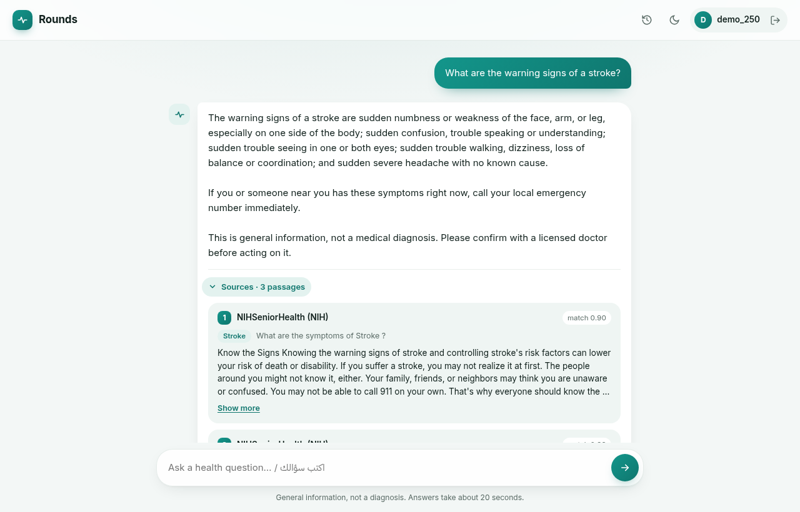
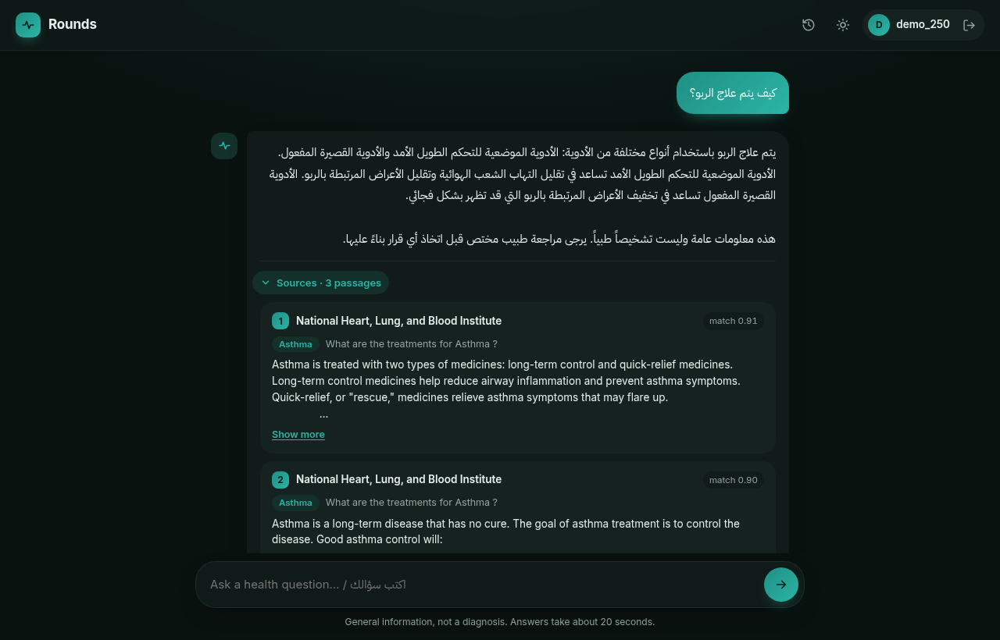
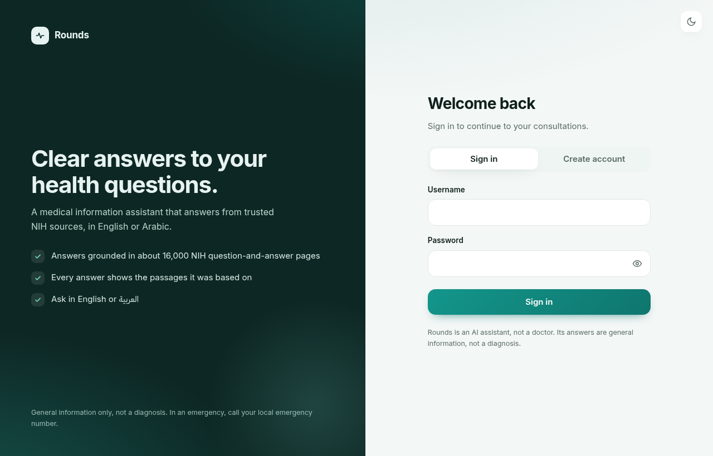
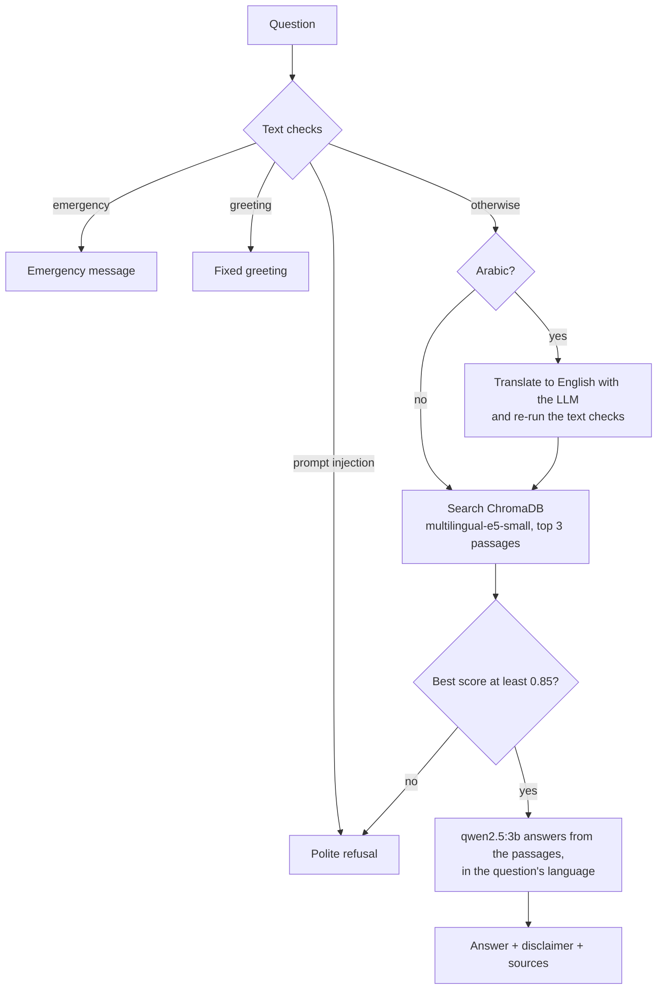

# Rounds: a medical RAG chatbot

Rounds answers health questions in **English or Arabic** using retrieval-augmented generation (RAG) over **16,412 NIH question–answer pairs** ([MedQuAD](https://github.com/abachaa/MedQuAD)). Every answer shows the exact passages it was based on. Everything runs locally on a CPU with one command: FastAPI, ChromaDB and a 3B model served by Ollama.



| Arabic, dark mode | Sign in |
|---|---|
|  |  |

> Rounds gives general information, not medical advice or a diagnosis. In an emergency, call your local emergency number.

## Features

- **Grounded answers with citations.** The model answers only from retrieved passages, and the response includes those exact passages: source organisation, topic, matched question and similarity score.
- **English and Arabic.** Each question is answered in its own language. Arabic questions are translated to English for retrieval, because the knowledge base is English.
- **Out-of-scope questions are refused.** If no passage is similar enough to the question, the assistant declines politely instead of guessing. The threshold is tuned on a separate dev set.
- **Safety checks before retrieval.** Emergencies ("I think I'm having a stroke") get an emergency message. Prompt-injection attempts are blocked. Greetings get an instant reply. All of these work in both languages.
- **Measured, not guessed.** `evaluate.py` reports Hit@k, MRR, answer rate, false refusals and safety results on frozen test sets. Every change in this project was checked against it ([results](#results)).
- **Accounts and history.** JWT sign-in, bcrypt passwords, and per-user chat history with sources, stored in SQLite.
- **One-command setup.** `docker compose up` downloads the model, builds the vector store and starts the app in the right order, using health checks.

## Quick start

**You need:** Docker with Compose v2, about **15 GB** of free disk space, and 8 GB of RAM. No GPU is needed.

```bash
git clone https://github.com/rasoolzoubi2003-dotcom/medical-ai-chatbot.git
cd medical-ai-chatbot

cp .env.example .env
# Set SECRET_KEY in .env, e.g. to the output of:
python3 -c "import secrets; print(secrets.token_urlsafe(48))"

docker compose up --build
```

Then open **http://localhost:8000**, create an account and ask a question.

The **first start is slow**. It downloads the `qwen2.5:3b` model (1.9 GB) and embeds the dataset into the vector store, which took about 28 minutes on an 8-thread laptop CPU (Intel i7-1185G7). Later starts take seconds: the store is reused as long as it's complete and the dataset and settings haven't changed. Answers take about 12 seconds in English and about 21 seconds in Arabic on the same CPU.

```bash
docker compose ps                        # the api service shows "healthy" once ready
curl localhost:8000/health               # {"status":"ok", ...}
docker compose exec api python evaluate.py   # run the evaluation (see below)
```

## How it works



1. **Text checks** ([safety.py](safety.py)) are plain rules, fast and predictable:
   - Phrases like "can't breathe" always trigger the emergency message.
   - Conditions like "stroke" trigger it only with wording that suggests it's happening now ("my dad *is having*…"). That way, "What are the warning signs of a stroke?" gets a real answer, with a note to call emergency services if it's happening right now.
   - Injection rules need instruction-like wording ("ignore … instructions"), so "How does insulin act as a hormone?" isn't blocked.
   - Arabic text is normalised first (diacritics; أ/إ/آ, ة/ه, ى/ي), so the rules match the way people actually type.
2. **Language.** A question is Arabic if it has more Arabic words than Latin ones, so "ما هو diabetes؟" counts as Arabic. Arabic questions are translated to English by the same LLM before retrieval. On the dev set, matching Arabic directly against English passages couldn't separate medical from off-topic questions; the translations separate as cleanly as English questions do.
3. **Retrieval** ([rag.py](rag.py)) embeds the question with `intfloat/multilingual-e5-small`, using the `query:` / `passage:` prefixes E5 expects. It then fetches the 3 most similar chunks by cosine similarity.
4. **Scope gate.** If the best chunk scores below `MIN_RELEVANCE_SCORE` (0.85), the question is refused without calling the LLM.
5. **Generation.** The passages and the question go to `qwen2.5:3b` with instructions to:
   - answer only from the context;
   - treat the question as untrusted input;
   - reply in the question's language.

   If the answer contains Chinese/Japanese/Korean characters (small multilingual models sometimes slip them into Arabic), the model is asked once to rewrite it.
6. **Response.** The answer gets a disclaimer, and an emergency note when relevant. The same passages that went into the prompt are returned as `sources`, so the citations always match what the model saw.

### Ingestion

[ingest.py](ingest.py) turns each CSV row into chunks of `Question: … / Answer: <part of the answer>`.
- **Every chunk repeats its question**, so no passage loses its topic.
- **Chunks are split by token count**, using the embedding model's own tokenizer: at most 200 answer tokens, well under the model's 512-token limit (the longest chunk is 247 tokens).
- **Cleanup:** 5 rows with empty answers and 48 duplicate rows are skipped, which leaves **35,767 chunks**.
- **Index settings:** the Chroma index is denser than the default (48 links per vector, search width 400). E5's similarity scores sit close together, and the default index skipped some true nearest neighbours.
- **Rebuild safety:** a finished build writes a marker with the chunk count and a fingerprint of the dataset and settings. An interrupted build, or a change to the data or settings, triggers a rebuild on the next run.

## Results

`evaluate.py` measures retrieval, the scope gate and the safety checks on **frozen** question sets, so every version is compared on the same questions:

| Set | Size | What it is |
|---|---|---|
| Dataset questions | 200 | Sampled from `medquad.csv` (seed 42), in the dataset's own wording |
| English hand-written | 16 | Natural rewordings, e.g. "What helps with psoriasis?" ([eval_questions.csv](eval_questions.csv)) |
| Arabic hand-written | 16 | Arabic translations of the same 16 ([eval_questions_ar.csv](eval_questions_ar.csv)) |
| Safety | 41 EN + 32 AR | Off-topic, injection, greeting and emergency messages ([EN](safety_questions.csv), [AR](safety_questions_ar.csv)) |

**How passages are scored.** A retrieved passage counts as correct only if it contains at least 60 consecutive characters of the expected answer. A passage that holds only the question text doesn't count.
- **Hit@k:** a correct passage appears in the top *k* results.
- **MRR:** the average of 1 / (rank of the first correct passage).
- **Answered:** the medical question passed the gate and reached the LLM.

The threshold is chosen with `--tune` on **separate dev sets** ([dev_questions.csv](dev_questions.csv), [dev_questions_ar.csv](dev_questions_ar.csv), plus 100 other dataset questions), never on the sets above.

### Before and after

Dataset questions / English hand-written / Arabic hand-written:

| Version | Hit@1 | Hit@3 | Hit@5 | MRR | Answered |
|---|---|---|---|---|---|
| Original pipeline | 12.5 / 18.8 / – | 29.0 / 37.5 / – | 41.5 / 62.5 / – | 0.223 / 0.309 / – | 5.0 / 6.2 / – % |
| Chunks keep their question, split by tokens | 75.5 / 87.5 / – | 96.0 / 93.8 / – | 99.0 / 93.8 / – | 0.855 / 0.906 / – | 5.0 / 6.2 / – % |
| Retrieval-score gate instead of an intent classifier | same / same / 0 | same / same / 0 | same / same / 0 | same / same / 0 | 100 / 100 / 0 % |
| **Multilingual embeddings + Arabic translation (current)** | **85.5 / 81.2 / 62.5** | **97.5 / 100 / 87.5** | **99.5 / 100 / 87.5** | **0.918 / 0.906 / 0.740** | **100 / 100 / 100 %** |

What each fix addressed:
- **Original pipeline:** chunking often separated questions from their answers (for 91% of questions, the top passage contained no answer text), and an anchor-phrase intent classifier rejected 95% of valid questions.
- **Gate:** "Answered" is the share of medical questions that reach the LLM; the gate change took it from 5% to 100%. The Arabic set was first measured here, with the English-only embedding model, and scored 0% on everything.
- **Current version:** no false refusals on any of the three sets.

**Safety (current version):**

| | Off-topic refused | Injection blocked | Greeting recognised | Emergency recognised |
|---|---|---|---|---|
| English | 15/15 | 12/12 | 6/6 | 8/8 |
| Arabic | 10/10 | 8/8 | 6/6 | 8/8 |

**Answer checks** (`evaluate.py --answers`, 32 real answers to the hand-written questions):
- 32/32 are in the question's language.
- The Chinese-character rewrite was needed for 4 answers, and none got through.
- Average 16.5 s per answer.

### Run it yourself

```bash
docker compose exec api python evaluate.py            # all results above (a minute or two)
docker compose exec api python evaluate.py --tune     # threshold sweep on the dev sets
docker compose exec api python evaluate.py --answers  # generate answers: language and speed checks
```

## Configuration

All settings come from environment variables; see [.env.example](.env.example). Only `SECRET_KEY` is required.

| Variable | Default | Meaning |
|---|---|---|
| `SECRET_KEY` | — | Signs login tokens (JWT). Required. |
| `ACCESS_TOKEN_EXPIRE_MINUTES` | `60` | How long a login stays valid |
| `API_PORT` | `8000` | Port published on the host |
| `OLLAMA_MODEL` | `qwen2.5:3b` | Chat model, downloaded on first start |
| `LLM_TEMPERATURE` | `0.1` | Sampling temperature |
| `LLM_MAX_TOKENS` | `200` | Maximum answer length |
| `LLM_TIMEOUT_SECONDS` | `120` | Give up on an answer after this long |
| `RETRIEVAL_K` | `3` | Passages retrieved per question |
| `MAX_CONTEXT_CHARS` | `3600` | Maximum context sent to the model |
| `MIN_RELEVANCE_SCORE` | `0.85` | Scope gate threshold; re-tune with `--tune` if you change data or models |
| `EMBEDDING_MODEL` | `intfloat/multilingual-e5-small` | Baked into the image; change it with `docker compose build --build-arg EMBEDDING_MODEL=…` |

**Why `qwen2.5:3b`?** I compared it with `llama3.2:3b` on the same questions and passages:
- `llama3.2:3b` doesn't officially support Arabic. It sometimes repeated phrases in a loop, gave wrong advice, and couldn't translate questions reliably.
- `qwen2.5:3b` was clearly better in Arabic, about 15% faster, and similar in English.

## API

Interactive docs are at **http://localhost:8000/docs**.

| Method | Path | Description |
|---|---|---|
| `POST` | `/register` | Create an account: `{"username", "password"}`. Username 3–30 characters (letters, digits, `_`); password at least 8 characters. Returns 201 / 409 / 422. |
| `POST` | `/token` | Sign in (OAuth2 form: `username`, `password`). Returns a bearer token, or 401. |
| `GET` | `/me` | The signed-in user |
| `POST` | `/chat` | `{"question"}` → `{"question", "answer", "sources": [{"question", "source", "topic", "excerpt", "score"}]}`. Returns 503 if the model or knowledge base isn't ready. |
| `GET` | `/history` | The user's past questions, answers and sources, newest first |
| `GET` | `/health` | 200 when the vector store is complete and the model is available, 503 otherwise |
| `GET` | `/` | The web UI |

All errors are JSON `{"detail": "<one readable sentence>"}`.

## Project structure

```
main.py            FastAPI app and endpoints
rag.py             retrieval, scope gate, translation, prompt and answer generation
safety.py          emergency / injection / greeting rules and fixed replies (EN + AR)
auth.py            password hashing, JWT tokens, current-user dependency
ingest.py          builds the vector store from medquad.csv
evaluate.py        evaluation, threshold tuning and answer checks
config.py          all settings, read from environment variables
database.py        SQLite connection
models.py          users and chat history tables
schemas.py         request and response models
index.html         the web UI (single file: plain HTML, CSS and JavaScript)
*_questions*.csv   evaluation, safety and dev question sets
medquad.csv        the knowledge base
Dockerfile, docker-compose.yml
```

**Docker services:**
- `ollama` runs the model server.
- `ollama-pull` and `ingest` are one-off jobs that download the model and build the vector store.
- `api` starts only after both jobs succeed.

The app image uses CPU-only PyTorch (3.3 GB instead of about 10 GB), includes the embedding model so containers start without internet, and runs as a non-root user. Data lives in named volumes: models, vector store and the SQLite database.

### Running without Docker

You need Python 3.12 and a local [Ollama](https://ollama.com) with `ollama pull qwen2.5:3b`.

```bash
python -m venv .venv && source .venv/bin/activate
pip install --index-url https://download.pytorch.org/whl/cpu torch==2.13.0
pip install -r requirements.txt
cp .env.example .env          # set SECRET_KEY
python ingest.py              # about 30 minutes on CPU
uvicorn main:app --reload
```

## Limitations

- **Small models make mistakes, especially in Arabic.** A 3B model on CPU sometimes mistranslates a term or picks a wrong word, e.g. it once called epilepsy "a mental disorder" instead of a neurological one. Translation errors also hurt retrieval: "الأكزيما" (eczema) is translated as "the flu", so the answer is about the wrong passages. The prompt then makes the model say it has no reliable information rather than make things up. The evaluation checks retrieval and routing, not the medical accuracy of the generated text.
- **The Arabic test sets are small (16 questions) and hand-made.** I wrote both the Arabic safety rules and the Arabic safety set, so those results are less independent than results from someone else's test set would be.
- **Sources show the organisation, not a link.** The dataset records which institute published each answer, not the page URL.
- **The token is kept in `localStorage`** so a page refresh doesn't sign you out. All text on the page is escaped. An httpOnly cookie with CSRF protection would be the stronger choice for production.
- **The knowledge base is static.** MedQuAD is a fixed snapshot of NIH web pages and is not updated.

## Data and credits

The knowledge base is **MedQuAD** (Medical Question Answering Dataset): A. Ben Abacha and D. Demner-Fushman, *"A question-entailment approach to question answering"*, BMC Bioinformatics 20, 511 (2019). MedQuAD is released under CC BY 4.0. The answers come from US National Institutes of Health websites: NIDDK, NINDS, NHLBI, NCI, GARD, Genetics Home Reference, MedlinePlus, NIHSeniorHealth and CDC.

Built with FastAPI, LangChain, ChromaDB, sentence-transformers, Ollama and SQLAlchemy.
